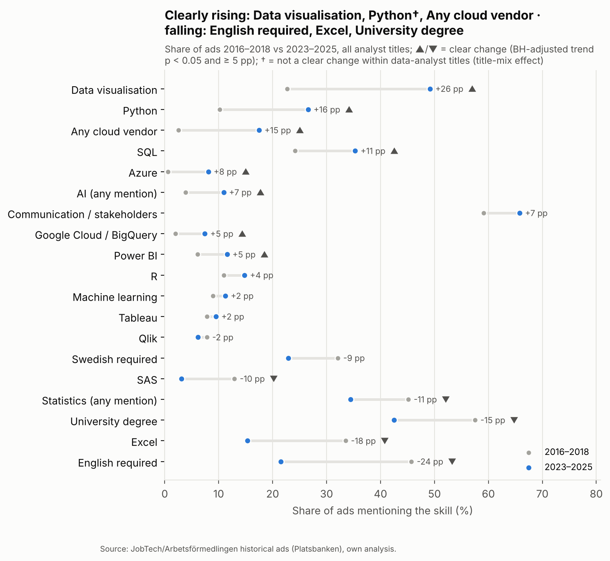
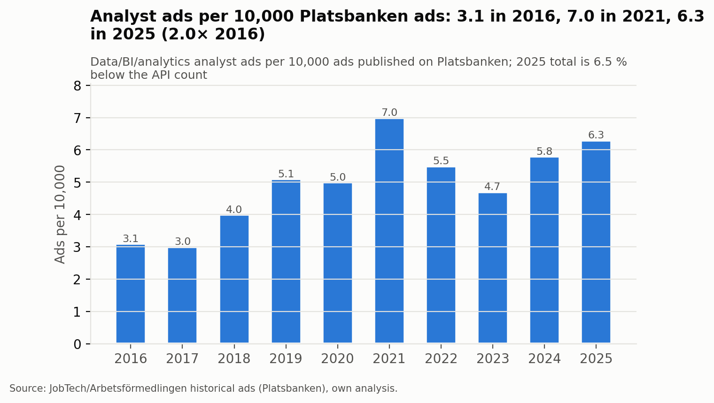
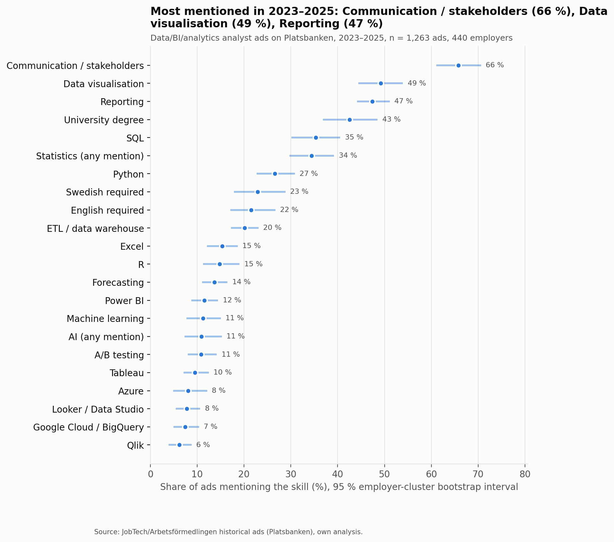
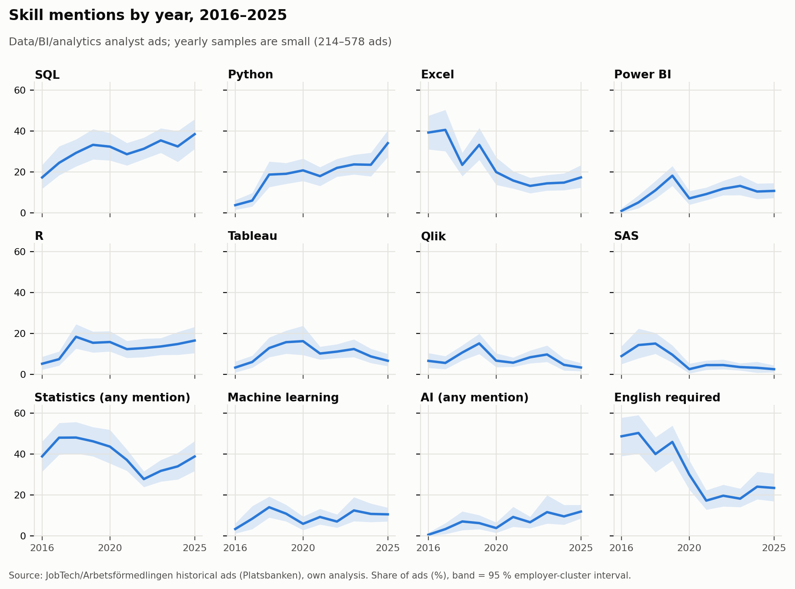
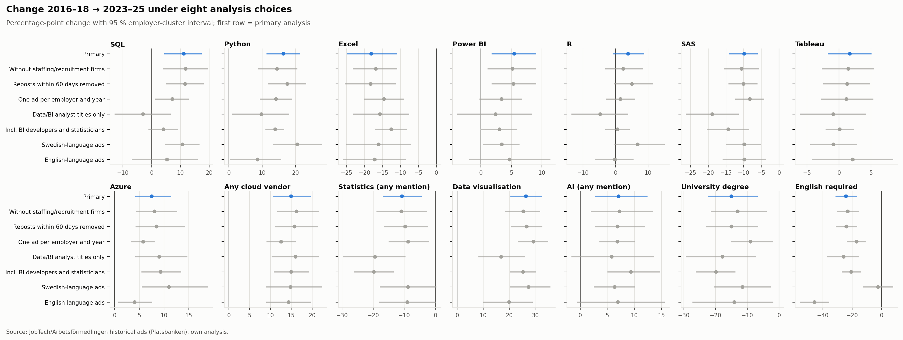

# What Swedish Employers Ask of Data Analysts

Which tools and skills do employers in Sweden ask for when they advertise data-analyst jobs, and how has that changed over ten years? This project reads every data, BI and analytics analyst ad published on Arbetsförmedlingen's Platsbanken from 2016 to 2025 (3,641 ads from 1,180 employers after removing reposts), measures the skills they mention with a validated text dictionary, and reports trends with intervals that account for employers posting many similar ads.



*† = the change is not clear within ads titled "data analyst" (finding 4). "English required" fell only in English-language ads (finding 5).*

## Business question

An education provider designing a data-analyst programme for the Stockholm labour market (a yrkeshögskola, university contract education or an employer's internal academy) has to decide which tools and methods get teaching time, and must document labour-market demand in its application. **Which skills do employers ask for, which are clearly rising or falling, and does Stockholm differ from the rest of Sweden?**

## Key findings

All data is real. Shares are "share of ads that mention the skill", with 95 % intervals from resampling employers (design effects of up to 8, so ordinary binomial intervals would be far too narrow).

1. **Demand doubled relative to the market and is concentrated in Stockholm.** Analyst ads went from 3.1 per 10,000 Platsbanken ads in 2016 to 6.3 in 2025. In Stockholms län the rate went 6.5 → 15.9; in the rest of Sweden 1.6 → 2.5.

   

2. **What ads ask for now (2023–2025, 1,263 ads from 440 employers):** communication/stakeholders 66 % (61–71 %), data visualisation 49 % (44–54 %), reporting 47 % (44–51 %), a university degree 43 % (37–49 %), **SQL 35 % (30–41 %)**, statistics 34 % (30–39 %), **Python 27 % (23–31 %)**, Excel 15 % (12–19 %), R 15 % (11–19 %), Power BI 12 % (9–14 %), Tableau 10 % (7–12 %), Azure 8 % (5–12 %), Google Cloud/BigQuery 7 % (5–10 %), AI (any mention) 11 % (7–15 %).

   

3. **Clearly falling, in all eight robustness variants:** **Excel 34 % → 15 %**, **SAS 13 % → 3 %** and degree requirements. Statistics mentions fall in every variant, clearly in most.
   **Clearly rising, in all eight variants:** **cloud data platforms 3 % → 17 %** (Azure, AWS, GCP, Snowflake, Databricks), **data visualisation 23 % → 49 %** and Python 10 % → 27 %. Looker/Data Studio and AI mentions rise in the main analysis but not clearly in every variant.

4. **SQL's rise is a change in job titles, not in the job.** Pooled, SQL goes 24 % → 35 %. But within ads titled data/BI analyst it is flat: 40 % → 42 %, a change of −3 pp (CI −13 to +7 pp). The rise comes from more ads being titled "data analyst" (17 % of the population in 2016, 69 % in 2025), a role that always asked for SQL. Python rises in every population: +10 pp (CI +1 to +18 pp) within data and BI analyst titles together, though within "data analyst" titles alone the rise (+7 pp) is not clear.

5. **"English required" fell, but demand for English did not.** Pooled it went 46 % → 22 %, but it fell −46 pp in English-language ads and −2 pp in Swedish-language ads, where 34–50 % ask for English every year. Newer English ads simply don't state it. Half of all analyst ads are now written in English.

6. **Stockholm asks for a different stack**, also after adjusting for year and title: SQL 42 % vs 25 % of ads (OR 2.07 (1.66–2.58)), Tableau OR 2.82 (1.99–3.99), Google Cloud/BigQuery OR 3.49 (2.15–5.68), Looker, A/B testing and dbt. Machine learning is *less* common in Stockholm ads: OR 0.53 (0.35–0.81).

7. **Skills come in bundles.** 76 % of ads that mention Python also mention SQL, and so do 65 % of Power BI ads.

8. **Generative AI has barely reached the ads:** 7 of 3,624 ads mention generative AI, LLMs, ChatGPT or Copilot, all in 2024–2025 (each match read and confirmed).



## Recommendation

For a data-analyst programme aimed at Stockholm, based on what employers write in their ads:

- **Core, every student:** SQL (the common denominator of the Python, Power BI and Stockholm stacks), one BI/visualisation tool taught in depth (Power BI is most common nationally; Tableau and Looker are relatively more common in Stockholm), and presenting results to non-technical stakeholders (two thirds of ads mention communication).
- **Second language:** Python rather than R. R is stable at about 15 % and appears mostly next to Python.
- **Add a cloud data-platform module** (one warehouse such as BigQuery or Azure, plus dbt): cloud platforms went from 3 % to 17 % of ads and are rising in every variant.
- **Drop dedicated modules** for SAS, SPSS, Stata and VBA (each ≤ 3 % of current ads). Teach Excel as a baseline, not a course.
- **Statistics:** keep, framed as applied analysis (A/B tests, forecasting) — a third of ads mention it, but fewer than in 2016–2018.
- **Generative AI:** teach it as a productivity tool, but don't market it as an employer requirement yet; re-check the ads in a year.
- Use the shares as **mentions**, not hard requirements, and as Platsbanken ads, not all jobs (see Limitations).

## Approach

1. **Population defined by headline, not occupation code** (`src/adskills/titles.py`, 40 tested examples). The JobTech taxonomy had no data-analyst code before 2023; analyst ads were spread over marketing, system and business analyst codes. Look-alikes such as "Online Data Analyst" (crowd-work rating gigs) and "Master Data Analyst" are excluded.
2. **Data quality** (`docs/data_quality.md`): the schema changed over the years, so JobTech's harmonised enriched files are used; yearly totals reconcile with JobTech's search API within ±0.5 % for 2016–2024; reposts by the same employer with identical text are removed (14 %).
3. **Skill extraction with a transparent regex dictionary** (`src/adskills/skills.py`, 36 skills, Swedish and English). Validated against independent annotation of a development sample (100 ads, used to fix rules) and a separate test sample (150 ads, compared only after the dictionary was committed). On the test sample, precision is ≥ 0.92 and recall ≥ 0.88 for all main tools; degree (recall 0.83), A/B testing (0.77) and Azure (0.75) are under-counted. One key ("cloud" as a word) failed the precision gate and is not ranked. JobTech's own skill tags agree with the dictionary on 94–99 % of ads and show the same trends.
4. **Uncertainty:** employer-cluster bootstrap intervals; logistic trend models with employer-clustered standard errors; Benjamini–Hochberg across 40 skills. "Clearly rising/falling" needs an adjusted p < 0.05, a change of at least 5 percentage points, and an interval that excludes 0. The plan was written down before any results (`docs/decisions.md`, D10).
5. **Composition and robustness:** every trend pooled, adjusted for title, and for data-analyst titles only; eight robustness variants (agencies, de-duplication rule, one ad per employer, title definitions, ad language).



## Data

| Source | Content | Access |
|---|---|---|
| [JobTech / Arbetsförmedlingen – historical job ads](https://jobtechdev.se/en/components/historical-ads), enriched files `berikade/kompletta/<year>_beta1_jsonl.zip` | Every ad on Platsbanken; 7.5 million records read for 2016–2025 (+ 2026-Q1 as a boundary file) | Open download, no key |
| [JobTech historical search API](https://historical.api.jobtechdev.se) | Yearly totals, used only for reconciliation | Open, no key |

**No ad text is published.** The yearly files (0.6–1.5 GB each) are streamed in GitHub Actions; the stage `build` turns each analyst ad into one row of metadata and 0/1 skill flags (`data/processed/ads_features.csv.gz`), and every result is computed from that file. Employer keys and headlines are stored only as hashes (used for de-duplication). Any ad can be looked up at JobTech by its id. Annotations for validation are kept as ad id + labels in `data/annotation/`; they were made by Claude (AI) sub-agents that saw only the ad text and the written guide, and the disagreements were adjudicated with a written reason for each.

## How to run

Every result can be reproduced offline from the committed features file (about 2 minutes). Rebuilding from the source (`fetch reconcile build`, then the offline stages) takes about 20 minutes and 10 GB of transfer, and is the only path that reads ad text.

```bash
# macOS / Linux
python -m venv .venv && source .venv/bin/activate
pip install -r requirements.txt
python -m pytest
python scripts/run_pipeline.py quality validate prevalence bundles robustness
python scripts/check_readme.py
```

```powershell
# Windows (PowerShell)
python -m venv .venv; .venv\Scripts\Activate.ps1
pip install -r requirements.txt
python -m pytest
python scripts/run_pipeline.py quality validate prevalence bundles robustness
python scripts/check_readme.py
```

Stages: `probe`, `schema`, `fetch`, `reconcile` (network); `build`, `annotate_prep` (need the fetched text); `quality`, `validate`, `prevalence`, `bundles`, `robustness` (offline, from the features file). `python scripts/run_pipeline.py` lists them. Python 3.12, seed fixed in `src/adskills/config.py`.

## Project structure

```
data/raw/            fetch manifest, yearly denominators, probe and schema output, API totals
data/processed/      ads_features.csv.gz (one row per ad, skill flags, no text) and analyst_ads.csv.gz (population, de-duplicated)
data/annotation/     sample ids, independent annotations (id + labels), adjudication with reasons
docs/                brief.md, data_quality.md, decisions.md, annotation_guide.md, qa.md
reports/             result JSON (validation, prevalence, bundles, robustness) and figures/
scripts/             run_pipeline.py (all stages), check_readme.py
src/adskills/        titles, skills, jobtech reader, scan, quality, validation, stats, analysis, figures
tests/               pytest suite (title rules, skill rules, reader, statistics, offline pipeline smoke tests)
```

## Limitations

- **Platsbanken is not the whole market.** Some employers advertise only on LinkedIn or their own site, and that share may have changed over the decade. Results describe Platsbanken ads.
- **A mention is not a requirement.** "Python is a plus" and "Python required" both count. Company descriptions count too (relevant for "AI (any mention)").
- **Ads are not vacancies, and not hires.** Volume is about advertising, not employment.
- **Small yearly samples** (214–578 ads per year after the text filter); single-year shares have wide intervals. Conclusions rest on pooled periods.
- **Measurement error:** recall below 0.85 for degree, A/B testing and Azure means those shares are under-counted; the dictionary was frozen before testing and the remaining misses are listed in `docs/decisions.md` (D14). Snowflake and YH had no positives in the test sample, so their accuracy is unmeasured.
- **2025 is 6.5 % short** of the API's yearly total; 2016–2024 match within half a percent. The gap sits in Dec 2024 – Apr 2025 (up to −25 % in April) and July; a small part is removed July–August ads missing from the file, the rest is located but not explained (`docs/data_quality.md`, section 2).
- **Annotation was AI-assisted** (independent sub-agents + adjudication by the analysis author), not done by human experts; all labels are in the repo for audit.
- Associations between region and skills are descriptive, not causal.

## Technology

Python 3.12 · pandas · statsmodels (GLM with clustered SEs) · ijson · matplotlib · pytest · GitHub Actions (data download and pipeline)
